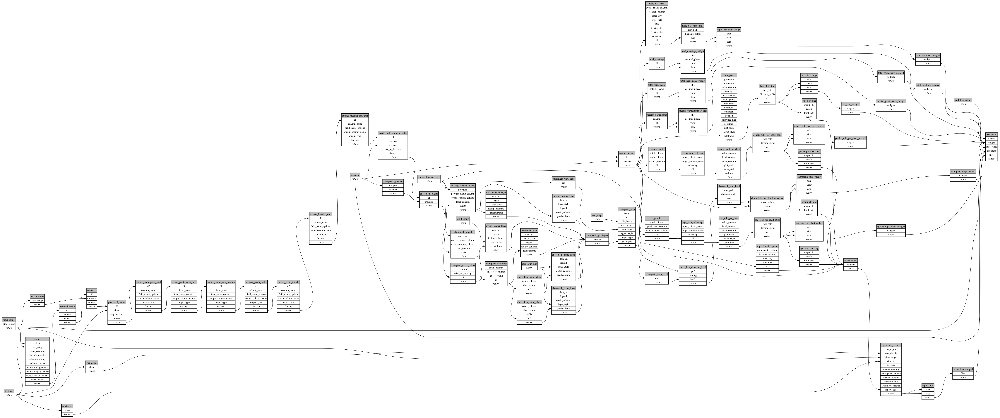

```
# AUTOGENERATED BY ECOSCOPE-WORKFLOWS; see fingerprint in README.md for details

```

```yaml
# fingerprint:
artifacts_sha256_basic: 3c9bf16fef1864a987dc0c264536940a06e7ac3499f70122cd434f75fe46938d
artifacts_sha256_strict: 4c41f91cfe96997ad430645d8c496b6f356fbb93496ce2c7e484086f1073c6ae
installed_requirements:
- channel: https://repo.prefix.dev/ecoscope-workflows/
  name: ecoscope-platform
  version: {version: ==2.28.0}
- channel: https://repo.prefix.dev/ecoscope-workflows-custom/
  name: ecoscope-workflows-ext-custom
  version: {version: ==0.1.5}
- channel: conda-forge
  name: pydeck
  version: {version: ==0.9.2}
- channel: https://repo.prefix.dev/ecoscope-workflows-custom/
  name: ecoscope-workflows-ext-eden
  version: {version: ==0.0.10}
params_sha256: e4b9f4c340c6884c7524e7e05d24108dbdb86dcf6cf9c9e7c4bb23ac8e92b52d
spec_sha256: 2eabe7e36a13b0d073bb37648478c01e43da9aca6a7f4940e56fbbafad23bdbd

```

# ecoscope-workflows-community-engagement-workflow


